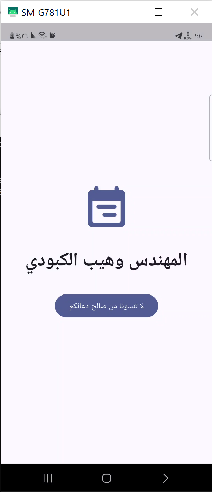

# جدولي | Jadwali

**تطبيق لتنظيم المهام والوقت ومتابعة الإنجاز والصلوات**

**تطوير:** وهيب الكبودي | Wahib Al-Kaboudi  
**المنصة:** Android / Flutter  
**التقنيات:** Flutter · Dart · Provider · SQLite

## نبذة عن المشروع

جدولي تطبيق عربي لتنظيم المهام والمواعيد ومتابعة الإنجاز اليومي والصلوات من خلال واجهات واضحة وتقويم وإحصائيات.

## الوظائف والمكونات الأساسية

- إضافة المهام وتحديد المواعيد والأولويات.
- قائمة الجدول اليومي والتقويم والتنقل بين التواريخ.
- إحصائيات الإنجاز والمهام.
- متابعة الصلوات وعرض إحصائياتها.
- إعدادات العرض والثيم والألوان.

## صور ومخططات المشروع



### بقية الواجهات

- [02 daily schedule](screenshots/02-daily-schedule.png)
- [03 task actions menu](screenshots/03-task-actions-menu.png)
- [04 add task](screenshots/04-add-task.png)
- [05 calendar](screenshots/05-calendar.png)
- [06 task statistics](screenshots/06-task-statistics.png)
- [07 settings](screenshots/07-settings.png)
- [08 prayer tracker](screenshots/08-prayer-tracker.png)
- [09 prayer statistics](screenshots/09-prayer-statistics.png)

## التقنيات المستخدمة

Flutter · Dart · Provider · SQLite

## التشغيل محليًا

```bash
flutter pub get
flutter run
```

## حالة المشروع وحدوده

يعرض المستودع الكود والواجهات المصورة. قد تتطلب الإشعارات إعداد صلاحيات الجهاز والتحقق من سلوكها في الخلفية.

## المطور وحقوق النشر

**وهيب الكبودي | Wahib Al-Kaboudi**  
Copyright © 2026 Wahib Al-Kaboudi. All rights reserved.

ما لم يُذكر ترخيص صريح آخر للملفات أو التبعيات، فإن نشر المصدر هنا لا يمنح تلقائيًا إذنًا بإعادة توزيعه أو استخدامه تجاريًا. تُحترم تراخيص المكتبات والبيانات والمكونات الخارجية كلٌّ بحسب شروطه.
