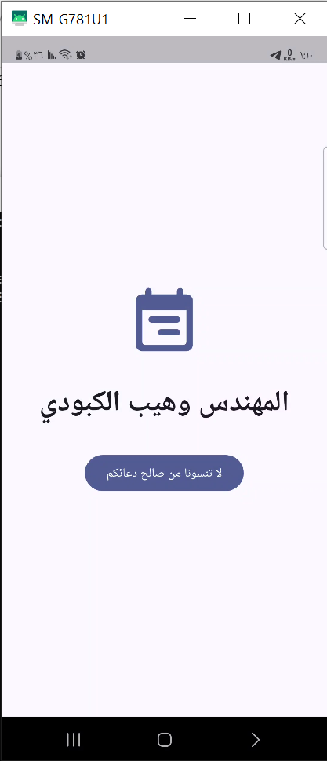
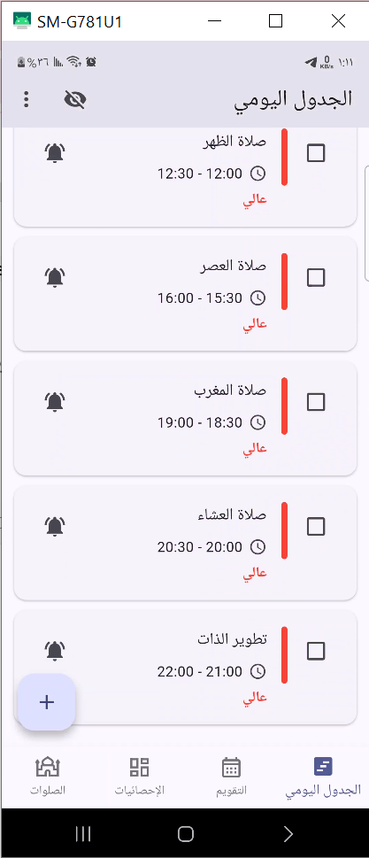
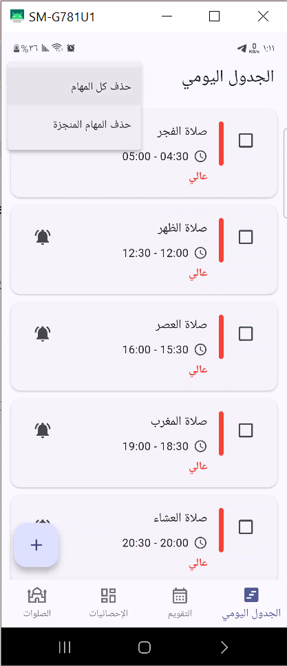
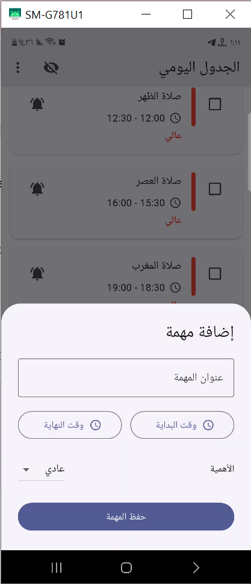
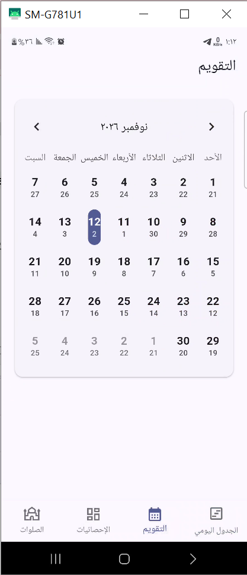
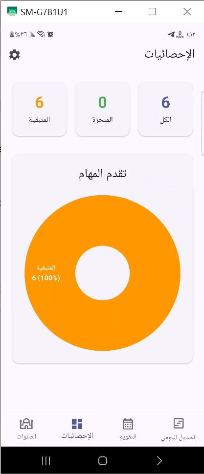
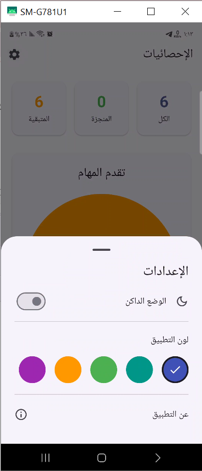
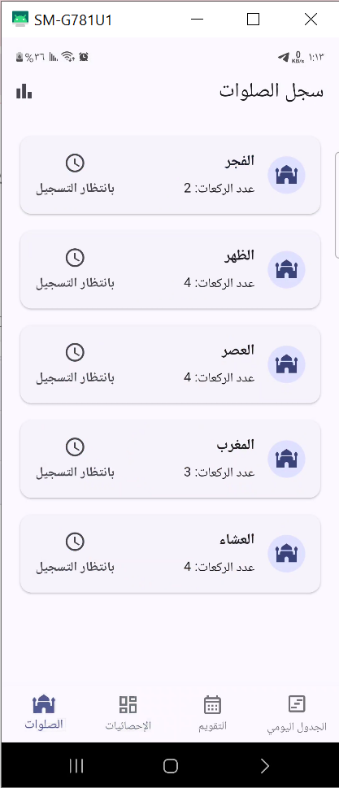
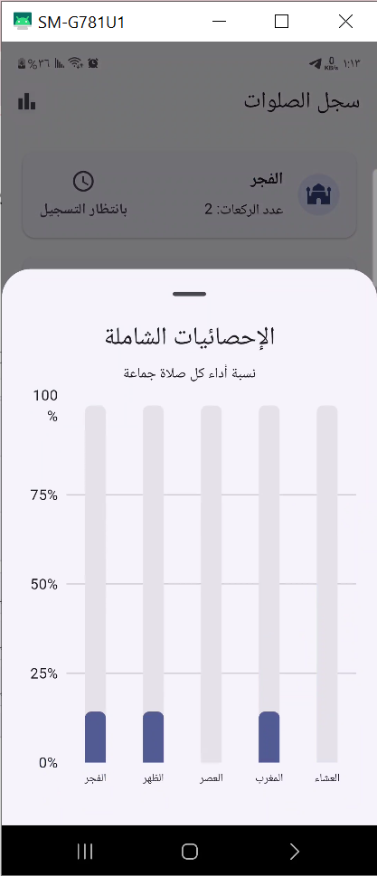

# دليل صور واجهات جدولي

جميع الصور أدناه مأخوذة من التطبيق أثناء تشغيله على Android. الصور تعرض الواجهات ولا تعني بالضرورة اختبار كل عملية.

## شاشة البداية
هوية التطبيق العربية وافتتاحية التجربة

## الجدول اليومي
بطاقات المهام والأوقات والأولويات

## إدارة قائمة المهام
خيارات حذف جميع المهام أو المهام المنجزة

## إضافة مهمة
عنوان المهمة ووقت البداية والنهاية والأولوية

## التقويم
الانتقال بين الأيام مع عرض اليوم الهجري والميلادي

## إحصائيات المهام
ملخص المنجز والمتبقي مع رسم بياني

## الإعدادات
الوضع الداكن والألوان ومعلومات التطبيق

## سجل الصلوات
متابعة الصلوات الخمس وتسجيل أدائها

## إحصائيات الصلوات
تصور بياني لنِسَب أداء الصلوات جماعة

